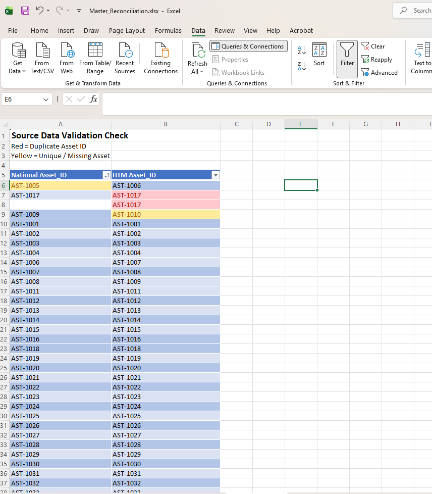
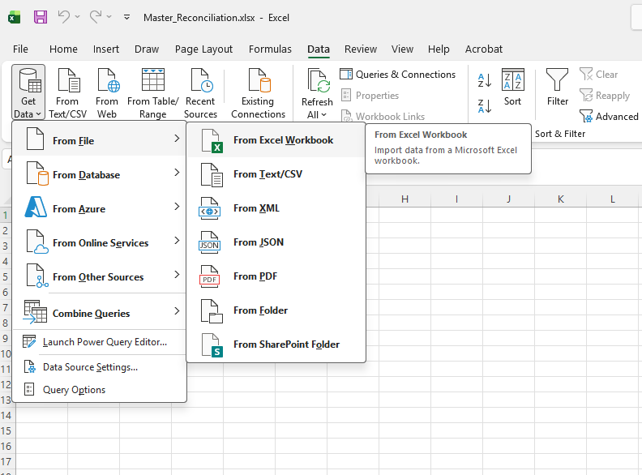
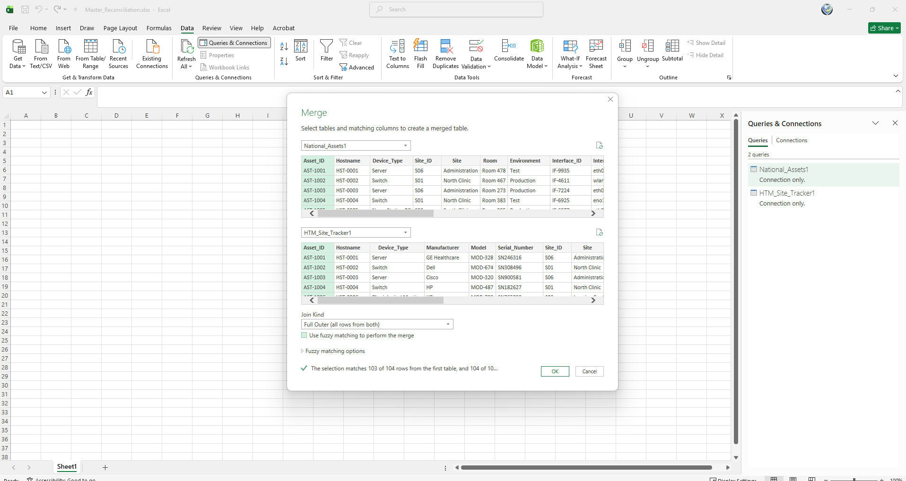
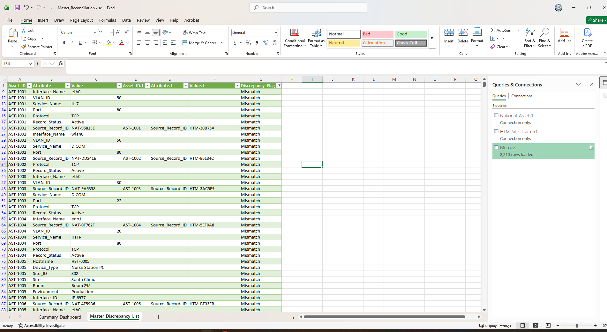
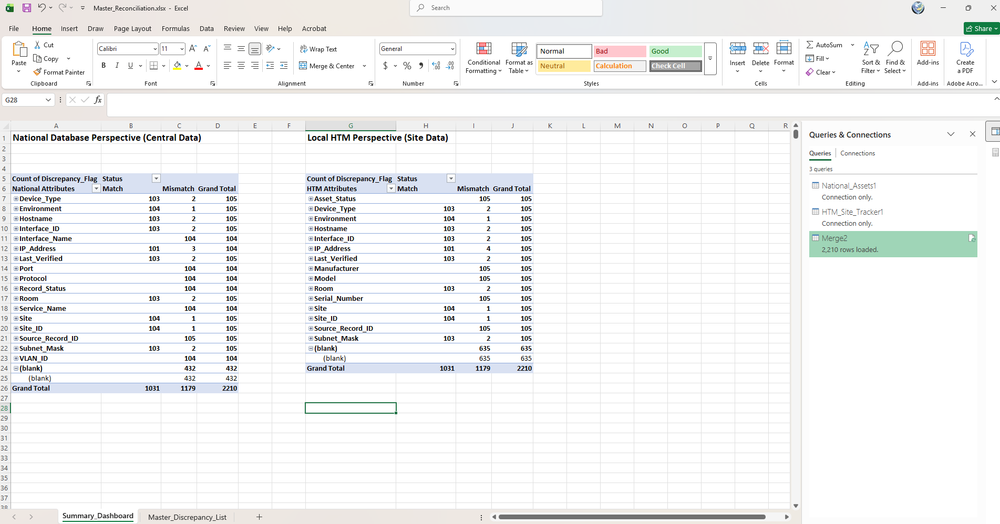

# Healthcare IT Asset Reconciliation Lab

## Project Overview
This repository contains a lab project focused on solving a common operational challenge: comparing a local hospital equipment list against a national database to find where records do not match. 

Because this is a student lab, the scope is intentionally focused on matching core Asset IDs and identifying basic missing items or duplicates. It serves as a proof of concept for building repeatable data workflows rather than a fully finished enterprise system.

---

## Repository Structure
* **`data/`**: Contains the raw spreadsheet files used for the exercise.
* **`screenshots/`**: Visual documentation of the step-by-step workflow.
* **`IT_Asset_Reconciliation_Master.xlsx`**: The final workbook containing the reconciliation logic and summary dashboard.

---

## Step-by-Step Workflow

### Step 1: Checking the Raw Data
Before merging any information, I checked the raw spreadsheets to catch basic data entry errors, such as blank rows, missing asset numbers, or duplicate entries.

### Step 2: Connecting the Files
Using Excel Power Query, I connected the source files to the workbook. This keeps the raw data safe and untouched while pulling it into the project.

### Step 3: Setting Up the Merge
This screenshot shows the setup window where I configured Excel to match the local tracker and the national database using the asset identification numbers before running the comparison.

### Step 4: The Master Discrepancy List
This is the main results table where all mismatched records are collected, making it easy to see which equipment records are missing or incorrect.

### Step 5: The Summary Dashboard
A simple Pivot Table dashboard that organizes the list of errors into clear numbers so an administrator can see the results at a glance.

---

## How to Test the Automation
To see how the workbook handles updated information:
1. Save updated spreadsheet files into the `data/` folder.
2. Open `IT_Asset_Reconciliation_Master.xlsx`.
3. Go to the Data tab at the top of Excel and click **Refresh All**.

---

## Project Limitations and Next Steps
As a learning lab, this project has intentional boundaries and is not yet ready for a live hospital environment. To expand this into a production-grade tool, future work would include:
* Adding checks for more complex details, such as verifying changing network IP addresses or serial numbers.
* Building smarter error handling that goes beyond matching just the primary identification numbers.
